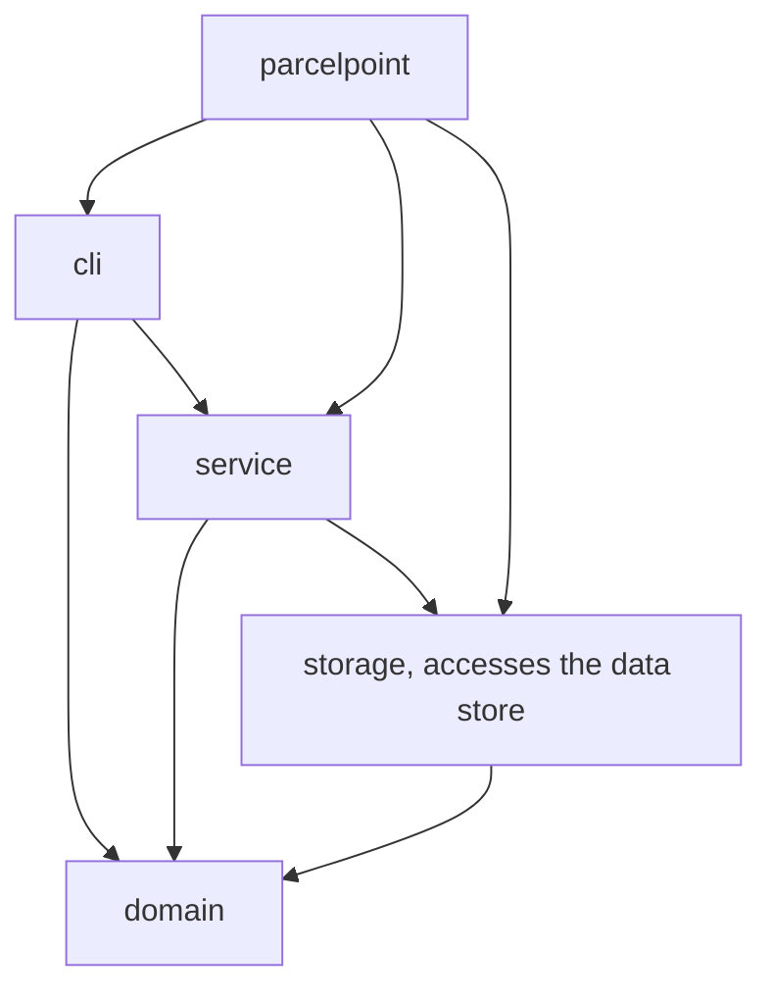
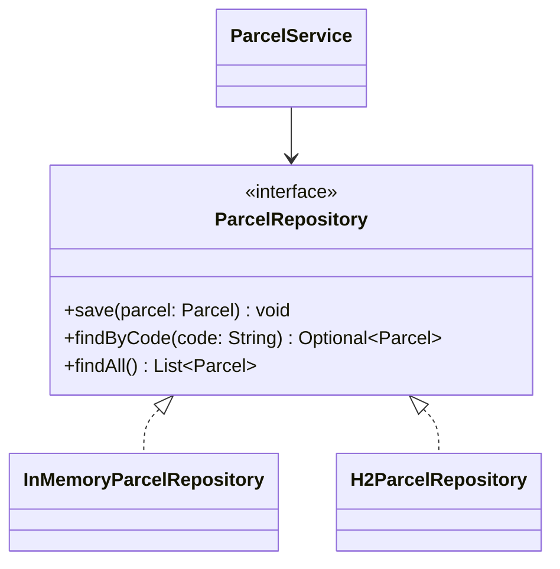
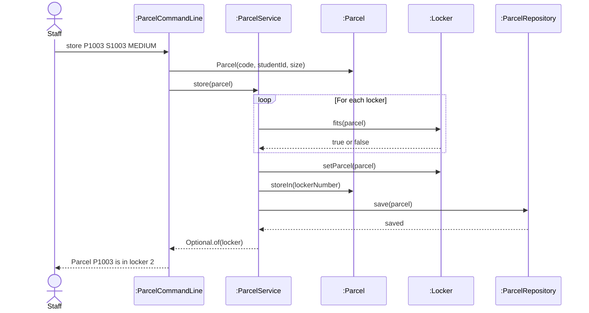

# Lab Report, Designing the Data Management Layer with H2

Repository URL: https://github.com/Natnicha0101/itcs382-h2-lab.git

## Tools

| Item | Version or name |
| --- | --- |
| JDK | 17.0.12 |
| Maven | 3.10.0 |
| IDE | VS Code 1.145.2 |
| AI tool and exact model, if you used one | ChatGPT (GPT-6 Luna) |

## Part 0. From a store in memory to H2

Commit of the starter, before any change: 7cddb6f

0.3 Your prediction for `staff`, written before the second run.
```text
I think no parcels will be listed and all lockers is free
```

Output of the second run, for `staff` and `quit`: 

```text
Free lockers: 3
```

State in one sentence where you think the parcels of the first run were kept.
```text
Ans: I think the parcels were kept in the program's memory.
```

0.5 The line of Main that you would change to keep the parcels somewhere else:

```java
ParcelRepository repository = new InMemoryParcelRepository();
```

0.6 Commit of the switch to H2.
```text
11eb866
```

0.7 Output of `SELECT * FROM PARCEL;` after you stored two parcels:

```text
CODE  | STUDENT_ID | PARCEL_SIZE | STATUS | LOCKER_NUMBER
P1001 | S1001      | SMALL       | STORED | 1
P1002 | S1002      | LARGE       | STORED | 3
(2 rows, 21 ms)
```

0.8 Explain why ParcelPoint could not start while the H2 Shell was open, and identify the class that wrote the message `Cannot create the PARCEL table`.
```text
Ans: ParcelPoint could not start because H2 Shell had already opened and locked the database file. The H2ParcelRepository class wrote the message `Cannot create the PARCEL table`.
```

0.9 Explain why `staff` shows no parcel while `find` shows each one, and why all three lockers look free.
```text
Ans: staff shows no parcel because findAll in H2ParcelRepository does not read parcels from the database yet. find shows each one because it uses findByCode to read a parcel from H2. The ParcelService constructor uses findAll to restore parcels to their lockers, so all three lockers appear free.
```

0.11 Your findAll method:

```java
@Override
public List<Parcel> findAll() {
    String sql = "SELECT * FROM PARCEL ORDER BY CODE";
    List<Parcel> parcels = new ArrayList<>();

    try (Connection connection = connect();
         PreparedStatement statement = connection.prepareStatement(sql);
         ResultSet row = statement.executeQuery()) {
        while (row.next()) {
            parcels.add(toParcel(row));
        }
    } catch (SQLException e) {
        throw new IllegalStateException("Cannot read the parcels", e);
    }

    return parcels;
}
```

Commit that adds findAll.
```text
28a631c
```

0.12 Output of `SELECT * FROM PARCEL;` after the pickup:

```text
CODE  | STUDENT_ID | PARCEL_SIZE | STATUS    | LOCKER_NUMBER
P1001 | S1001      | SMALL       | PICKED_UP | null
P1002 | S1002      | LARGE       | STORED    | 3
(2 rows, 21 ms)
```

0.13 Optional. Describe what `find P9999'OR'1'='1` showed while the SQL was joined from strings, and what it showed after you put the placeholder back.

## Part A. Model the design

A1 Complete the flowchart with one node for each package and one arrow for each dependency, from the package that uses to the package that is used. Mark the package that accesses the data store.



State whether cli depends on storage, and explain why.
```text
Ans: No. The cli package depends on service and domain, but it does not depend on storage. ParcelCommandLine calls ParcelService and does not use storage classes.
```

A2 Complete the class diagram of the data management layer with ParcelService, the interface ParcelRepository with its three operations, and the two classes that implement it.



A3 Draw a sequence diagram for the command `store P1003 S1003 MEDIUM`, from the staff member to the repository. Show each message as an operation of the class that receives it.



Explain why the last lifeline is the interface ParcelRepository rather than H2ParcelRepository.
```text
Ans: The last lifeline is the interface ParcelRepository because ParcelService depends on the interface. 
```

## Part B. Design questions

1. Identify the files that you changed to move from the store in memory to H2, and explain why no other class had to change. Use the terms of this course.
```text
Ans: I changed Main.java to use H2ParcelRepository because ParcelService depends on the ParcelRepository interface, so the rest of the program does not depend on the specific data store. This follows the Dependency Inversion Principle.
```

2. The PARCEL table stores the size of a parcel as SMALL, MEDIUM or LARGE rather than as 1, 2 or 3. Identify the type of connascence between ParcelSize and the table in each case, and explain which one is weaker.
```text
Ans:The table stores names such as SMALL, so the code and table have connascence of name because they must use the same names. If the table stores numbers such as 1, 2, and 3 it has connascence of convention because both sides must agree on the meaning of each number. Connascence of name is weaker because the meaning is explicit.
```

3. Project Phase 2 asks for a data store that needs no separate server. Explain why an embedded database such as H2 meets this rule, and describe the limit of an embedded database that Step 0.8 showed.
```text
Ans: H2 meets the rule because it runs inside the Java program as a library and does not need a separate database server. However, when a program is using the database file, another program cannot access it because the file is locked.
```

4. State the data store that you would choose for your Project Phase 2 team, files or an embedded database, the requirement that drives the choice, and the package that will access it.
```text
Ans: I would choose an embedded database because it keeps data after the program ends and does not need a separate server. The storage package will access the database.
```

## AI usage declaration

| AI tool and exact model | Date | Purpose | Files or answers it produced or changed | How you checked its output |
| --- | --- | --- | --- | --- |
| ChatGPT (GPT-6 Luna) | 10 November 2026 | To understand the lab steps, check English grammar, and get help with the findAll method and diagrams | LAB_REPORT.md and H2ParcelRepository.java | I compared the advice with the lab PDF, checked the code, and ran the program and SQL queries.|
